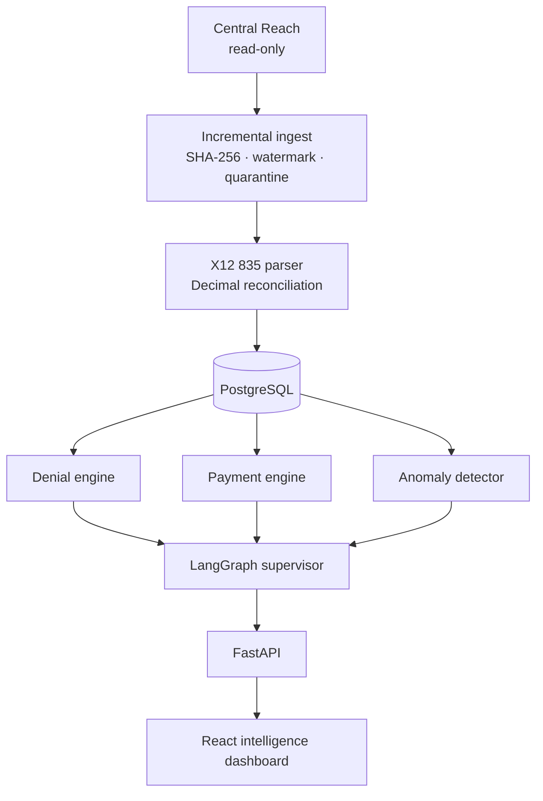

<div align="center">

# PMAB Remittance Intelligence

**The 835 comes in. The money is reconciled. The denial has a name. The exposure is on the screen.**

[](https://github.com/Manoj-calpion/pmab-remittance-intelligence./actions/workflows/ci.yml)

An agentic ERA / X12 835 platform for payment, denial, and payer intelligence.

`Python 3.12` · `FastAPI` · `LangGraph` · `React` · `PostgreSQL` · `Amazon Bedrock`

</div>

---

Central Reach stays **read-only**. Every dollar is calculated in Python with `Decimal`. Five agents explain only what the tools already proved. A missing contract stays missing. A missing date stays missing. The model never invents a reimbursement.

## Synthetic demo, calculated live

These figures come from the checked-in 835 corpus. They are labeled synthetic. They are not an approved payer result.

| | |
| --- | ---: |
| Remittances parsed | **27** |
| Quarantined / duplicate | **1 / 1** |
| Claims analyzed | **117** |
| Denial rate | **21.4%** |
| Denied amount | **$3,860.00** |
| Underpayment exposure | **$350.00** `synthetic_demo` |
| Delayed payments | **6** `synthetic_demo` |
| Critical anomaly | **Synthetic Payer North** · not a confirmed payment error |

## What the platform decides

| Question | Deterministic answer |
| --- | --- |
| Why was it denied? | CARC and RARC mappings. Contractual write-offs and patient responsibility are not denials. |
| Which payer is drifting? | Volume, denial rate, denied amount, delays, and underpayment exposure. |
| How late is the payment? | Approved submission or acceptance date to payment date. A service date is never treated as a submission date. |
| Where is the underpayment? | Approved contract rule versus actual reimbursement. No rule means insufficient data. |
| Is it an authorization problem? | Adjustments mapped to authorization. |
| Is it a coding problem? | Adjustments mapped to coding. |
| Is the spike real? | Modified z-score against history. A statistical anomaly is a lead, not a confirmed financial error. |

## Pipeline



Agents have no SQL and no path back into Central Reach.

| Agent | Job |
| --- | --- |
| Denial intelligence | Categories, payers, procedure codes |
| Payment intelligence | Delays, underpayments, calculation traces |
| Payer intelligence | Behavior and monthly movement |
| Root cause | Correlation and missing evidence. A hypothesis is not a confirmed cause. |
| Insight and reporting | Executive narrative built from tool output |

The supervisor routes, then stops. Bedrock stays closed until `BEDROCK_PHI_APPROVED=true` and a model ID are set. Until then a labeled mock provider narrates the same evidence. A failed Bedrock call is not silently replaced with a mock. Exposure at or above **$1,000.00** waits for human review.

## Run it

Python 3.12. Docker and Node are optional. No AWS account required.

```powershell
cd backend
python -m pip install -e ".[dev]"
cd ..
$env:DEMO_MODE = "true"
$env:LLM_PROVIDER = "mock"
python -m uvicorn app.main:app --app-dir backend --host 127.0.0.1 --port 8000
```

```powershell
cd frontend
npm install
npm run dev
```

| Surface | Address |
| --- | --- |
| Dashboard | http://127.0.0.1:5173 |
| API | http://127.0.0.1:8000 |
| API reference | http://127.0.0.1:8000/docs |

Demo mode ingests `sample_data/synthetic_835` into an empty database and loads labeled demo contracts and submission dates. The login form fills the analyst account.

| Email | Password | Role |
| --- | --- | --- |
| `analyst@pmab.demo` | `ChangeMe-Demo-Only` | Analyst |
| `admin@pmab.demo` | `ChangeMe-Demo-Only` | Admin |
| `viewer@pmab.demo` | `ChangeMe-Demo-Only` | Viewer |

`docker compose up --build` brings up PostgreSQL with pgvector, Redis, the API, a Celery worker, and the dashboard. The worker stays idle unless `USE_CELERY=true`.

```powershell
cd backend
python -m pytest
cd ../frontend
npm test
```

## Stack

| Layer | Choice |
| --- | --- |
| API | FastAPI, Pydantic v2, SQLAlchemy 2, Alembic |
| Money and files | Python `Decimal`, Polars, custom X12 835 parser |
| Data | PostgreSQL locally via Docker; SQLite for a zero-dependency demo |
| Agents | LangGraph supervisor, read-only tools, Amazon Bedrock when approved |
| UI | React, TypeScript, Vite, Tailwind, TanStack Query, Apache ECharts |
| Jobs | Celery and Redis, or inline execution |
| Cloud shape | Terraform for a private VPC, RDS, encrypted S3, ECS Fargate, SQS, Cognito, KMS, CloudWatch |

Production startup refuses demo mode, the default JWT secret, SQLite, and local file storage. The Terraform definition has not been applied. Applying it creates billable AWS resources.

## Rules that do not bend

- Central Reach is never modified, posted, corrected, or resubmitted.
- No Central Reach endpoint is invented. The connector refuses every call until an approved specification exists.
- No payer contract, denial code, payment date, or claim is fabricated.
- Every file is validated. Malformed files are quarantined. Duplicates are caught by SHA-256.
- Raw 835 contents are not logged. Patient identifiers require `phi:view`.
- This repository does not claim HIPAA compliance.

Open business inputs live in [`docs/implementation/missing-requirements.md`](docs/implementation/missing-requirements.md). Read that file before treating any figure as a recovery demand.
